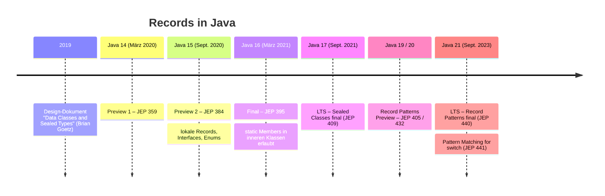
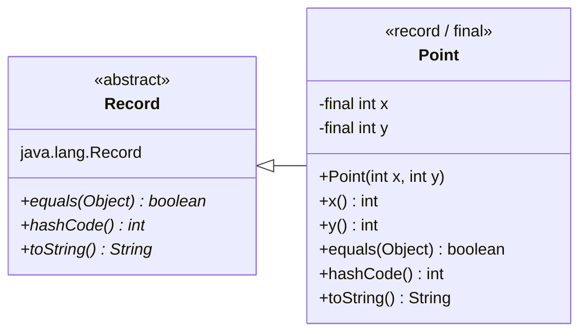
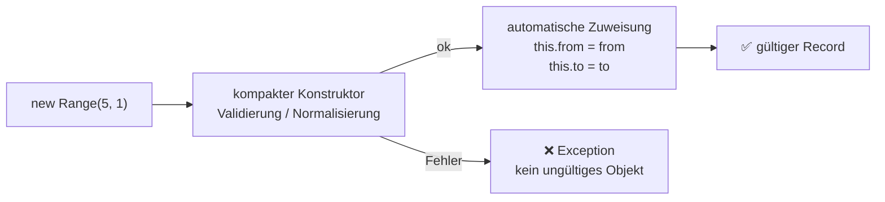
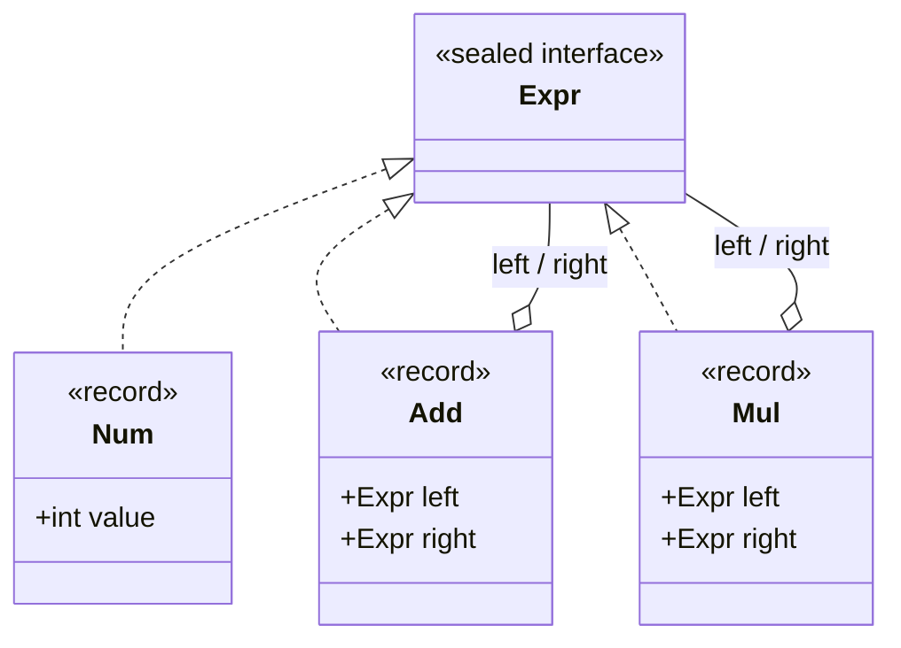

# Records – Datenklassen in einer Zeile

**Records** sind eine spezielle Art von Klassen für **unveränderliche
Datenträger** ("transparent carriers for immutable data"). Man beschreibt
nur noch **welche Daten** ein Typ hat – Konstruktor, Getter, `equals()`,
`hashCode()` und `toString()` erzeugt der Compiler.

Gültig für **Java 16+** (final), Record Patterns final in **Java 21**.

---

## 1. Historie: Wie es zu Records kam

### 1.1 Das Problem: Boilerplate

Vor Records sah eine einfache Datenklasse in Java so aus:

```java
public final class Point {
    private final int x;
    private final int y;

    public Point(int x, int y) {
        this.x = x;
        this.y = y;
    }

    public int getX() { return x; }
    public int getY() { return y; }

    @Override
    public boolean equals(Object o) {
        if (this == o) return true;
        if (!(o instanceof Point)) return false;
        Point p = (Point) o;
        return x == p.x && y == p.y;
    }

    @Override
    public int hashCode() { return Objects.hash(x, y); }

    @Override
    public String toString() { return "Point[x=" + x + ", y=" + y + "]"; }
}
```

**~30 Zeilen** für eine Information: *"Ein Punkt besteht aus x und y."*

Typische Folgen:

- `equals()`/`hashCode()` werden beim Hinzufügen eines Feldes **vergessen**
- Fehleranfällige, schwer zu reviewende Routine-Implementierungen
- Ausweichen auf **Lombok** (`@Value`, `@Data`) oder IDE-Generatoren
- Die **Absicht** ("das ist nur ein Datenträger") ist im Code nicht
  erkennbar

### 1.2 Vorbilder in anderen Sprachen

| Sprache  | Konstrukt          | seit    |
|----------|--------------------|---------|
| Scala    | `case class`       | 2006    |
| Kotlin   | `data class`       | 2016 (1.0) |
| C#       | `record`           | 2020 (C# 9) |
| Java     | Lombok `@Value`    | Bibliothek, kein Sprachmittel |

### 1.3 Project Amber und die Zeitleiste

Records entstanden in **Project Amber** (Leitung: Brian Goetz) – zusammen
mit `var`, switch Expressions, Text Blocks, Sealed Classes und Pattern
Matching. Bewusstes Designziel war **nicht** "weniger Tipparbeit",
sondern **semantisch**: ein Record *ist* seine Daten – nicht mehr und
nicht weniger.



| Java-Version | Status     | JEP     | Änderungen                                          |
|--------------|------------|---------|-----------------------------------------------------|
| 14           | Preview 1  | JEP 359 | erste Version von `record`                          |
| 15           | Preview 2  | JEP 384 | lokale Records / Enums / Interfaces, Feinschliff    |
| **16**       | **Final**  | JEP 395 | Records final; innere Klassen dürfen `static` Members haben |
| 19           | Preview    | JEP 405 | Record Patterns (Dekonstruktion)                    |
| 20           | Preview 2  | JEP 432 | Record Patterns in erweiterten `for`-Schleifen (später wieder entfernt) |
| **21 (LTS)** | **Final**  | JEP 440 | Record Patterns final, auch verschachtelt           |
| 22           | Final      | JEP 456 | `_` als unbenanntes Pattern: `case Point(int x, _)` |

---

## 2. Grundlagen: Ein Record in einer Zeile

```java
public record Point(int x, int y) { }
```

Das ist **alles**. Die Klammer `(int x, int y)` ist der **Record-Header**,
`x` und `y` sind die **Record-Komponenten**.

### Was der Compiler daraus erzeugt



| Bestandteil                       | Erzeugt als                                     |
|-----------------------------------|-------------------------------------------------|
| Felder                            | `private final` je Komponente                   |
| Kanonischer Konstruktor           | `Point(int x, int y)`                           |
| Zugriffsmethoden (Accessors)      | `x()`, `y()` – **ohne** `get`-Präfix            |
| `equals()` / `hashCode()`         | über **alle** Komponenten                       |
| `toString()`                      | `Point[x=1, y=2]`                               |
| Oberklasse                        | `java.lang.Record`                              |
| Klasse                            | implizit `final`                                |

### Verwendung

```java
Point p = new Point(1, 2);

System.out.println(p.x());                       // 1
System.out.println(p);                           // Point[x=1, y=2]
System.out.println(p.equals(new Point(1, 2)));   // true
```

---

## 3. Was Records dürfen – und was nicht

### ✅ Erlaubt

```java
public record Range(int from, int to) implements Comparable<Range> {

    // statische Felder und Methoden
    public static final Range EMPTY = new Range(0, 0);

    public static Range of(int from, int to) { return new Range(from, to); }

    // zusätzliche Instanzmethoden
    public int length() { return to - from; }

    // Interfaces implementieren
    @Override
    public int compareTo(Range o) { return Integer.compare(from, o.from); }

    // weitere Konstruktoren – müssen an den kanonischen delegieren
    public Range(int to) { this(0, to); }
}
```

- Interfaces implementieren (auch **sealed** Interfaces)
- statische Felder, Methoden, verschachtelte Typen
- zusätzliche Methoden und Konstruktoren
- Accessors, `equals`, `hashCode`, `toString` **überschreiben**
- Annotationen an Komponenten
- Generics: `record Pair<A, B>(A first, B second) { }`

### ❌ Nicht erlaubt

| Verbot                                      | Grund                                  |
|---------------------------------------------|----------------------------------------|
| `extends` einer anderen Klasse              | Oberklasse ist immer `java.lang.Record` |
| von einem Record erben                      | Records sind implizit `final`          |
| zusätzliche **Instanz**felder               | Zustand = genau die Komponenten        |
| Felder neu zuweisen                         | Komponenten sind `final`               |
| `abstract` Record                           | ein Record ist immer konkret           |
| `native` Methoden                           | –                                      |

---

## 4. Konstruktoren: Validierung und Normalisierung

### 4.1 Kompakter Konstruktor (empfohlen)

Ohne Parameterliste – die Zuweisung an die Felder erfolgt **automatisch
am Ende**:

```java
public record Range(int from, int to) {
    public Range {
        if (from > to) {
            throw new IllegalArgumentException(
                "from (%d) > to (%d)".formatted(from, to));
        }
    }
}
```

Normalisieren durch Neuzuweisung der **Parameter**:

```java
public record Name(String value) {
    public Name {
        Objects.requireNonNull(value);
        value = value.strip();    // Parameter, nicht this.value!
    }
}
```

### 4.2 Kanonischer Konstruktor (ausgeschrieben)

```java
public record Range(int from, int to) {
    public Range(int from, int to) {
        if (from > to) throw new IllegalArgumentException();
        this.from = from;
        this.to = to;
    }
}
```



> **Merksatz:** Ein Record mit Validierung im Konstruktor kann **nie in
> einem ungültigen Zustand existieren**.

---

## 5. Achtung: "flache" Unveränderlichkeit

Records sind nur **shallowly immutable** – die *Referenzen* sind final,
nicht die referenzierten Objekte:

```java
record Team(String name, List<String> members) { }

var list = new ArrayList<>(List.of("Anna"));
var team = new Team("Dev", list);
list.add("Bernd");                 // ändert den Record "von außen"!
team.members().add("Clara");       // ebenso
```

**Lösung:** defensive Kopie im kompakten Konstruktor

```java
record Team(String name, List<String> members) {
    Team {
        members = List.copyOf(members);   // unveränderliche Kopie
    }
}
```

---

## 6. Lokale Records

Records lassen sich direkt in Methoden definieren – ideal für
Zwischenergebnisse, z. B. in Streams:

```java
List<String> topSeller(List<Order> orders) {

    record SellerSum(String seller, double sum) { }

    return orders.stream()
        .collect(Collectors.groupingBy(Order::seller,
                 Collectors.summingDouble(Order::amount)))
        .entrySet().stream()
        .map(e -> new SellerSum(e.getKey(), e.getValue()))
        .sorted(Comparator.comparingDouble(SellerSum::sum).reversed())
        .limit(3)
        .map(SellerSum::seller)
        .toList();
}
```

Lokale Records sind **implizit `static`** – sie können nicht auf lokale
Variablen der umgebenden Methode zugreifen.

---

## 7. Records und Pattern Matching (Java 21)

### 7.1 Record Patterns mit `instanceof`

```java
// Java 16: Type Pattern
if (obj instanceof Point p) {
    System.out.println(p.x() + p.y());
}

// Java 21: Record Pattern – direkt dekonstruieren
if (obj instanceof Point(int x, int y)) {
    System.out.println(x + y);
}
```

### 7.2 Verschachtelte Record Patterns

```java
record Point(int x, int y) { }
record Line(Point start, Point end) { }

if (obj instanceof Line(Point(var x1, var y1), Point(var x2, var y2))) {
    double length = Math.hypot(x2 - x1, y2 - y1);
}
```

### 7.3 Records + Sealed Interfaces = algebraische Datentypen

```java
sealed interface Expr permits Num, Add, Mul { }
record Num(int value)          implements Expr { }
record Add(Expr left, Expr right) implements Expr { }
record Mul(Expr left, Expr right) implements Expr { }

static int eval(Expr e) {
    return switch (e) {
        case Num(int v)          -> v;
        case Add(Expr l, Expr r) -> eval(l) + eval(r);
        case Mul(Expr l, Expr r) -> eval(l) * eval(r);
    };   // kein default – exhaustiv dank sealed
}
```



→ Details siehe Kapitel **Sealed Classes** (`sealed_classes.md`) und
**Pattern Matching für switch** (`../01_SwitchExpressionAndTextBlocks/SWITCH.md`).

---

## 8. Reflection und Serialisierung

```java
Point.class.isRecord();                          // true
for (RecordComponent rc : Point.class.getRecordComponents()) {
    System.out.println(rc.getName() + " : " + rc.getType());
}
// x : int
// y : int
```

- **Serialisierung:** Records implementieren `Serializable` wie normale
  Klassen, werden aber **immer über den kanonischen Konstruktor**
  deserialisiert → Validierung greift auch beim Deserialisieren.
- **Jackson** (ab 2.12), **JPA-Projektionen**, **Spring**
  (`@ConfigurationProperties`) unterstützen Records direkt.
- **JPA-Entities** sind dagegen **kein** Einsatzgebiet: Entities brauchen
  einen No-Arg-Konstruktor und veränderlichen Zustand.

---

## 9. Records vs. Klasse vs. Lombok

| Aspekt                 | klassische Klasse | Lombok `@Value`  | `record`            |
|------------------------|-------------------|------------------|---------------------|
| Boilerplate            | hoch              | gering           | minimal             |
| Sprachmittel           | ja                | nein (Annotation Processor) | ja       |
| Accessor-Namen         | frei (`getX()`)   | `getX()`         | `x()`               |
| Vererbung              | ja                | nein (final)     | nein (final)        |
| zusätzliche Felder     | ja                | ja               | nein                |
| Pattern Matching       | nur Type Pattern  | nur Type Pattern | **Record Patterns** |
| Builder                | manuell           | `@Builder`       | manuell             |

### Typische Einsatzgebiete

- DTOs / API-Antworten
- Value Objects (Geldbetrag, Koordinate, Zeitraum)
- Schlüssel in `Map`s (korrektes `equals`/`hashCode` gratis)
- Zwischenergebnisse in Streams (lokale Records)
- Nachrichten / Events in sealed Hierarchien

---

## 10. Merksätze

> **Ein Record ist seine Daten – nicht mehr und nicht weniger.**

> **Records sind final, ihre Felder auch – aber nur flach unveränderlich.**

> **Validierung gehört in den kompakten Konstruktor.**

> **sealed interface + record + switch = typsichere Fallunterscheidung ohne default.**

---

## 11. Hinweis zu Mermaid-Support

- GitHub: ✅ (auch `timeline`)
- IntelliJ Markdown Preview: ✅
- VS Code (mit Mermaid-Plugin): ✅
- PDF-Exporter: abhängig vom Tool

---

Ende des Kapitels.
