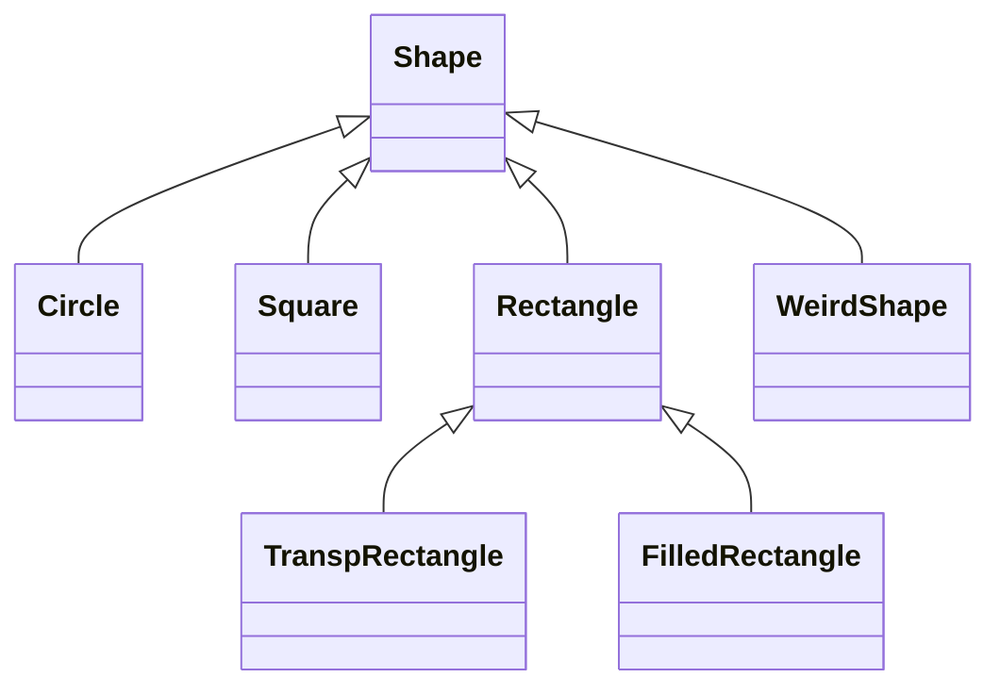
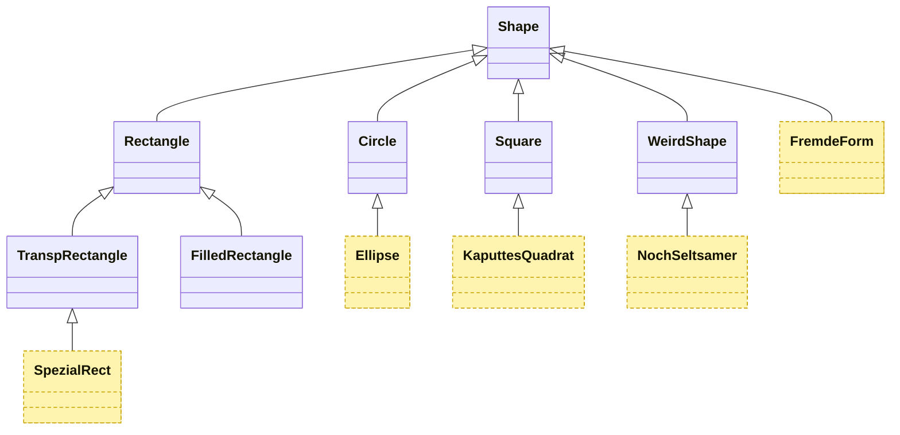
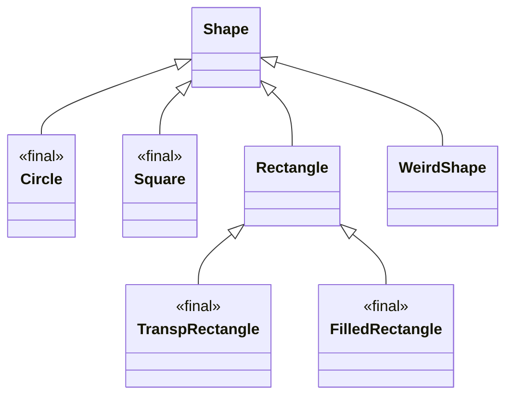
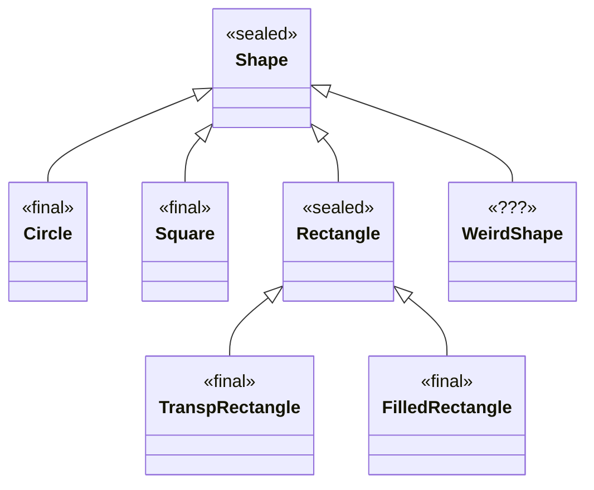
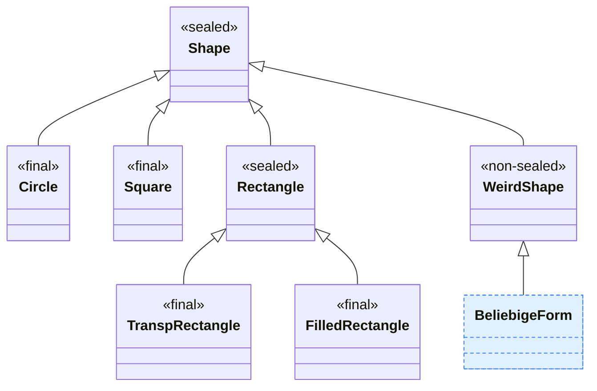
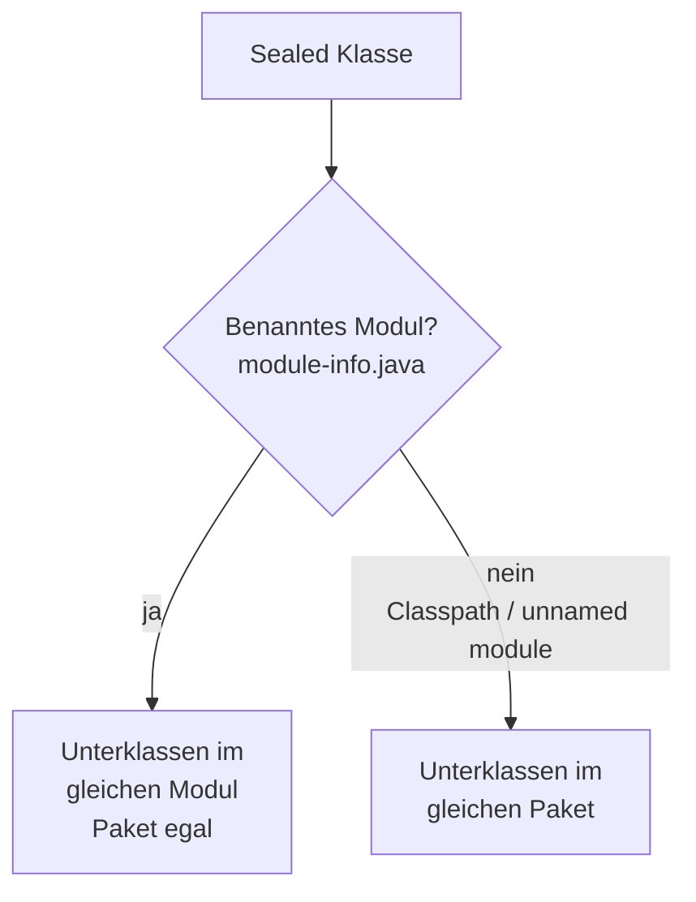
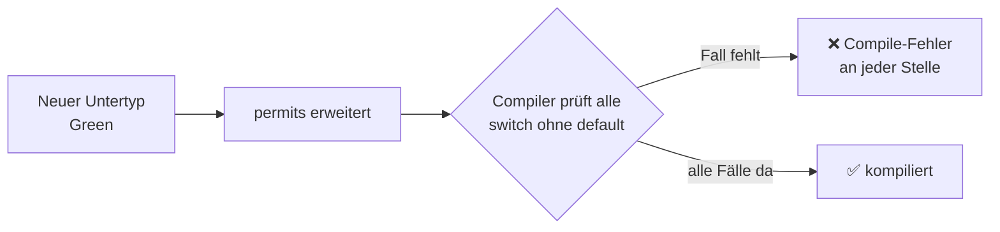
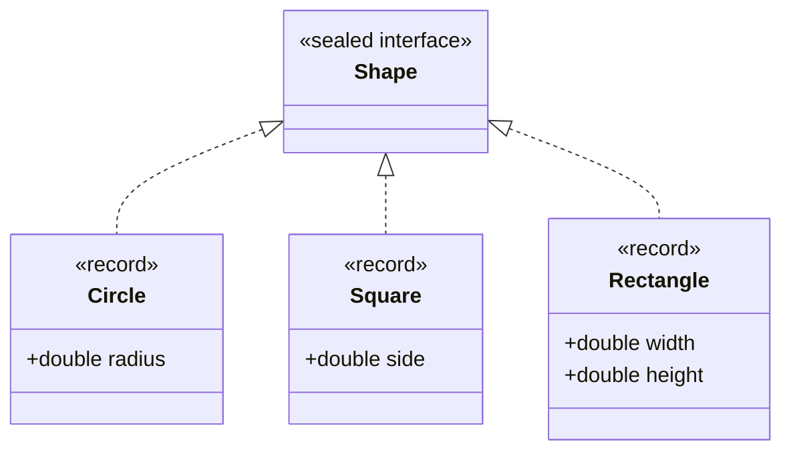

# Sealed Classes und Sealed Interfaces

Mit **Sealed Classes** (versiegelten Klassen) legt eine Klasse oder ein
Interface selbst fest, **welche Klassen es direkt erweitern bzw.
implementieren dürfen**. Damit wird aus einer offenen Vererbungshierarchie
eine **abgeschlossene, dem Compiler bekannte Menge von Untertypen**.

Gültig für **Java 17+** (final), sinnvoll kombinierbar mit **Records** und
**Pattern Matching for switch** (final in **Java 21**).

---

## 1. Ausgangslage: eine offene Klassenhierarchie

Als durchgängiges Beispiel dient eine Hierarchie geometrischer Formen:

```java
public class Shape { ... }

public class Circle    extends Shape { ... }
public class Square    extends Shape { ... }
public class Rectangle extends Shape { ... }
public class WeirdShape extends Shape { ... }

public class TranspRectangle  extends Rectangle { ... }
public class FilledRectangle  extends Rectangle { ... }
```

### Diagramm: Ausgangssituation



### Diagramm: Was ohne Einschränkung alles möglich ist

Ohne Einschränkung kann **jede** Klasse von **jeder** dieser Klassen erben –
auch aus fremdem Code, den wir nicht kennen (hier mit `???` markiert):



---

## 2. Warum sollte man Vererbung einschränken?

- **Schutz des inneren Zustands:** Unterklassen können Invarianten der
  Oberklasse verletzen (z. B. ein `Square`, dessen Seiten plötzlich
  unterschiedlich lang sind).
- **Thread-Sicherheit / Kapselung:** Interne Objekte sollen nicht über
  überschriebene Methoden an fremden Code "durchsickern".
- **Liskovsches Substitutionsprinzip:** Unbekannte Unterklassen können den
  Vertrag der Oberklasse brechen.
- **Exhaustiveness:** Kennt der Compiler *alle* Untertypen, kann er bei
  `switch` prüfen, ob alle Fälle behandelt sind – **ohne `default`**.
- **Fachliche Modellierung:** Viele Domänen haben eine *feste* Menge von
  Varianten (Zahlungsart, Ereignistyp, Ergebnis `Ok`/`Fehler` …).
  Sealed Types bilden das direkt im Typsystem ab
  (→ **algebraische Datentypen**, "Summentypen").

---

## 3. Schritt für Schritt zur versiegelten Hierarchie

### 3.1 Erster Versuch: `final`

`final` verhindert **jede** Vererbung. Das passt für die "Blätter" der
Hierarchie:

```java
public final class Circle          extends Shape     { ... }
public final class Square          extends Shape     { ... }
public final class TranspRectangle extends Rectangle { ... }
public final class FilledRectangle extends Rectangle { ... }
```



**Problem:** `Shape` und `Rectangle` können **nicht** `final` sein – sie
haben ja selbst Unterklassen. Trotzdem darf jeder von ihnen erben.

> Die frühere Notlösung *package-private Oberklasse* ist keine echte
> Alternative: Dann ist `Shape` außerhalb des Pakets gar nicht mehr sichtbar.

---

### 3.2 `sealed` und `permits`

Mit `sealed` wird eine Klasse versiegelt, `permits` zählt die **erlaubten
direkten Unterklassen** auf:

```java
public sealed class Shape
        permits Circle, Square, Rectangle, WeirdShape { ... }

public sealed class Rectangle extends Shape
        permits TranspRectangle, FilledRectangle { ... }
```



Jetzt kann niemand mehr eine neue Form direkt unter `Shape` oder
`Rectangle` einhängen.

---

### 3.3 Pflicht: `final`, `sealed` oder `non-sealed`

Jede erlaubte Unterklasse **muss** explizit sagen, wie es weitergeht.
Fehlt der Modifier, meldet der Compiler:

```text
WeirdShape.java:3: error: sealed, non-sealed or final modifiers expected
public class WeirdShape extends Shape {
       ^
```

| Modifier      | Bedeutung                                             |
|---------------|-------------------------------------------------------|
| `final`       | Hierarchie endet hier – keine Unterklassen            |
| `sealed`      | erneut versiegelt, eigene `permits`-Liste             |
| `non-sealed`  | **bewusst wieder geöffnet** – beliebige Unterklassen  |

Soll `WeirdShape` absichtlich erweiterbar bleiben:

```java
public non-sealed class WeirdShape extends Shape { ... }
```

### Diagramm: fertige Hierarchie



> **Merksatz:** Wer eine versiegelte Hierarchie wieder öffnet, muss das
> mit `non-sealed` **ausdrücklich hinschreiben** – ein "versehentliches"
> Öffnen gibt es nicht.

---

### 3.4 Sealed Interfaces

Alles gilt genauso für Interfaces – in der Praxis ist das sogar der
häufigere Fall:

```java
public sealed interface Payment permits CreditCard, Invoice, PayPal { }

public final class CreditCard implements Payment { ... }
public final class Invoice    implements Payment { ... }
public non-sealed class PayPal implements Payment { ... }
```

Ein sealed Interface darf auch von **Interfaces** erweitert werden
(diese müssen dann `sealed` oder `non-sealed` sein, `final` gibt es für
Interfaces nicht).

---

### 3.5 Zur Laufzeit prüfen: Reflection

Seit Java 17 bietet `java.lang.Class` zwei neue Methoden:

```java
System.out.println(Shape.class.isSealed());                 // true
System.out.println(Arrays.toString(
        Shape.class.getPermittedSubclasses()));              // [class Circle, class Square, class Rectangle, class WeirdShape]

System.out.println(WeirdShape.class.isSealed());            // false
System.out.println(WeirdShape.class.getPermittedSubclasses()); // null
```

> Hinweis: Ein `enum`, bei dem mindestens eine Konstante einen eigenen
> Rumpf `{ ... }` hat, ist **implizit sealed**.

---

## 4. Besonderheiten und Regeln

### 4.1 `permits` weglassen – gleiche Compilation Unit

Stehen alle Unterklassen in **derselben Quelldatei**, darf `permits`
entfallen. Der Compiler ermittelt die Liste selbst:

```java
public sealed class Result {
    public static final class Ok    extends Result { }
    public static final class Error extends Result { }
}
```

### 4.2 Wo dürfen erlaubte Unterklassen liegen?



- Jede Klasse in `permits` muss die versiegelte Klasse **direkt**
  erweitern. Ein "Enkel" in der Liste führt zu `invalid permits clause`.
- Jede Klasse in `permits` muss zur Compile-Zeit **existieren und
  erreichbar** sein.

### 4.3 Lokale und anonyme Klassen

```java
void demo() {
    class LocalChild extends NonSealedParent { }  // ✅ erlaubt
    class LocalChild2 extends SealedParent { }    // ❌ Fehler
    Shape s = new Shape() { };                    // ❌ anonyme Klasse – Fehler
}
```

Lokale und anonyme Klassen dürfen **keine** sealed Klasse erweitern bzw.
kein sealed Interface implementieren – sie könnten ja nie in einer
`permits`-Liste stehen.

### 4.4 Schlauere `instanceof`-Prüfungen

Der Compiler nutzt das Wissen über die Hierarchie auch bei Casts und
`instanceof`:

```java
interface A { }
class B { }

boolean isAaB(A a) { return a instanceof B; } // ✅ kompiliert:
// es könnte eine Klasse C extends B implements A geben
```

```java
sealed interface A permits AChild { }
final class AChild implements A { }
class B { }

boolean isAaB(A a) { return a instanceof B; } // ❌ incompatible types: A cannot be converted to B
```

Da `A` versiegelt ist und `AChild` `final`, **kann** es kein `A` geben,
das gleichzeitig ein `B` ist – der Compiler weiß das.

### 4.5 Kontextuelle Schlüsselwörter

`sealed`, `non-sealed` und `permits` sind – wie `yield` oder `record` –
**kontextuelle Schlüsselwörter**. Bestehender Code bleibt kompilierbar:

```java
public void sealed() {
    int permits = 5;     // ✅ als Methoden- / Variablennamen erlaubt
}
```

Nur als **Typname** sind `sealed` und `permits` seit Java 15 verboten.

---

## 5. Exhaustiveness: Sealed Types + Pattern Matching for switch

Der eigentliche Gewinn zeigt sich beim `switch` (final seit **Java 21**,
JEP 441):

```java
public sealed interface Color permits Red, Blue { }
public final class Red  implements Color { }
public final class Blue implements Color { }

String name(Color color) {
    return switch (color) {
        case Red r  -> "rot";
        case Blue b -> "blau";
        // kein default nötig – der Compiler kennt alle Fälle
    };
}
```

Kommt später ein neuer Untertyp hinzu …

```java
public sealed interface Color permits Red, Blue, Green { }
public final class Green implements Color { }
```

… meldet der Compiler **jede** unvollständige Stelle:

```text
error: the switch expression does not cover all possible input values
```



> **Tipp:** Bei sealed Hierarchien bewusst **kein `default`** schreiben.
> Ein `default` würde neue Untertypen still "schlucken" und die
> Compiler-Prüfung aushebeln.

> Ab **Java 22** kann man nicht benötigte Variablen mit `_` weglassen:
> `case Red _ -> "rot";` – im Java-21-Kurs nutzen wir noch benannte
> Variablen.

---

## 6. Sealed Interfaces + Records + Record Patterns

Records sind **implizit `final`** und passen deshalb perfekt als Blätter
einer versiegelten Hierarchie – ohne zusätzlichen Modifier:

```java
public sealed interface Shape permits Circle, Square, Rectangle { }

public record Circle(double radius)                implements Shape { }
public record Square(double side)                  implements Shape { }
public record Rectangle(double width, double height) implements Shape { }
```



Mit **Record Patterns** (final in Java 21, JEP 440) wird daraus ein sehr
kompakter, typsicherer Code:

```java
static double area(Shape shape) {
    return switch (shape) {
        case Circle(double r)               -> Math.PI * r * r;
        case Square(double s)               -> s * s;
        case Rectangle(double w, double h)  -> w * h;
    };
}
```

Das ist das Muster der **algebraischen Datentypen**:

| Baustein           | Rolle                              |
|--------------------|------------------------------------|
| `sealed interface` | **Summentyp** – "entweder … oder …" |
| `record`           | **Produkttyp** – "… und …"          |
| `switch` + Pattern | vollständige, sichere Auswertung   |

---

## 7. Historie

| Java-Version | Status             | JEP     | Bemerkung                                    |
|--------------|--------------------|---------|----------------------------------------------|
| 15           | Preview 1          | JEP 360 | Einführung `sealed`, `non-sealed`, `permits` |
| 16           | Preview 2          | JEP 397 | Feinschliff, u. a. Regeln für Casts          |
| **17 (LTS)** | **Final**          | JEP 409 | `Class.isSealed()`, `getPermittedSubclasses()` |
| 17–20        | Preview            | –       | Pattern Matching for switch                  |
| **21 (LTS)** | **Final**          | JEP 440 / 441 | Record Patterns, Pattern Matching for switch → Exhaustiveness |
| 22           | Final              | JEP 456 | Unnamed Variables & Patterns `_`             |

Sealed Classes stammen – wie Records, Text Blocks, switch Expressions und
Pattern Matching – aus **Project Amber**.

---

## 8. Merksätze

> **`sealed` + `permits` = "Nur diese dürfen erben."**

> **Jede erlaubte Unterklasse ist `final`, `sealed` oder `non-sealed`.**

> **Sealed Types machen `switch` vollständig prüfbar – kein `default` nötig.**

> **sealed interface + record = algebraischer Datentyp in Java.**

---

## 9. Hinweis zu Mermaid-Support

- GitHub: ✅
- IntelliJ Markdown Preview: ✅
- VS Code (mit Mermaid-Plugin): ✅
- PDF-Exporter: abhängig vom Tool

---

Ende des Kapitels.
